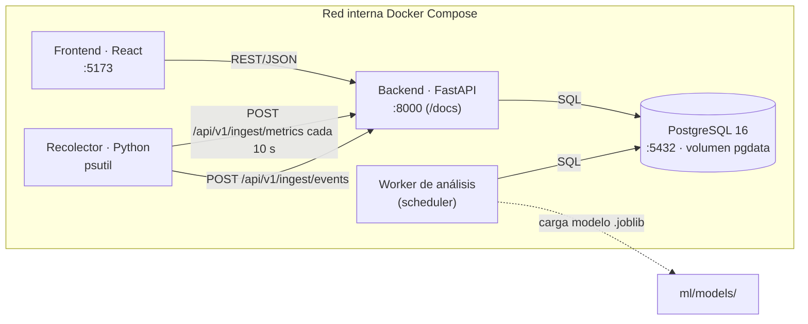
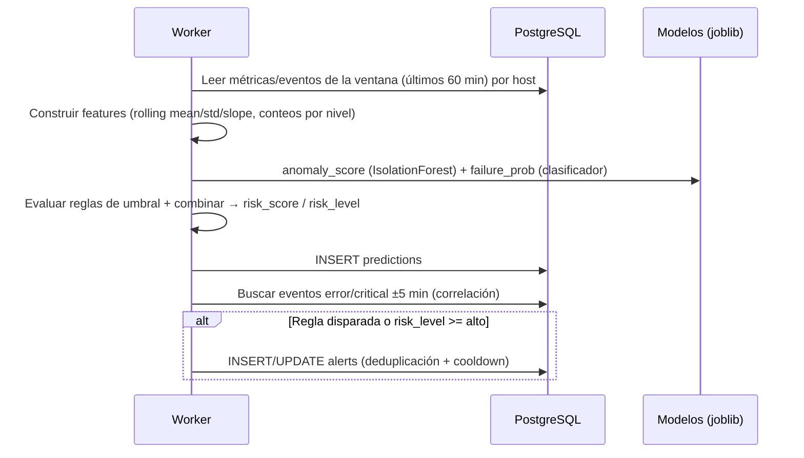

# 02 · Arquitectura

## Vista por capas

| Capa | Componentes (MVP) | Responsabilidad |
|---|---|---|
| Fuentes | Hosts simulados/contenedores, apps de prueba | Generar datos operativos |
| Recolección | `COLLECTOR` (Python + psutil), generador de logs | Capturar métricas y logs, enviarlos a la API |
| Ingesta / API | FastAPI (`BACK`) | Validar, persistir, exponer datos y alertas |
| Procesamiento | Worker de análisis (APScheduler en MVP → Celery + Redis opcional) | ETL, features, scoring, reglas, alertas |
| Datos | PostgreSQL 16 | Configuración, métricas, eventos, alertas, predicciones, incidentes |
| Analítica / IA | `ml/` (pandas, scikit-learn, statsmodels, joblib) | Entrenamiento, evaluación, artefactos de modelo |
| Presentación | React + TypeScript + Vite + Tailwind + Recharts (`FRONT`) | Dashboards, alertas, predicciones, historial |
| Infraestructura | Docker, Docker Compose, GitHub Actions, Nginx (prod) | Contenedores, CI/CD, despliegue |

## Diagrama de contenedores (desarrollo)



> Regla: **el backend es el único que escribe datos de dominio desde fuera**; el worker comparte el paquete `app` del backend (mismos modelos SQLAlchemy) y corre como proceso separado.

## Flujo operativo

```mermaid
flowchart LR
  A[Infraestructura] --> B[Métricas / Logs / Eventos] --> C[Recolección] --> D[Ingesta + validación]
  D --> E[Normalización / features] --> F[Detección de anomalías] --> G[Evaluación de riesgo]
  G --> H[Correlación de evidencias] --> I[Alerta inteligente] --> J[Dashboard] --> K[Respuesta técnica / Incidente]
  K --> L[Registro del resultado → re-entrenamiento]
```



## Flujo de predicción y alerta (cada ciclo del worker, 60 s)



## Decisiones técnicas (ADR resumidos)

| # | Decisión | Motivo | Estado |
|---|---|---|---|
| ADR-01 | **Python 3.11** en todos los contenedores (la propuesta decía 3.12) | Ya definido en Dockerfiles; compatibilidad de libs | Aceptada |
| ADR-02 | **React + TypeScript** con Vite y Tailwind | Tipado compartido con contratos de la API | Aceptada |
| ADR-03 | Recolector propio con **psutil** en lugar de Prometheus en el MVP | Menos piezas, control total del payload; Prometheus/Grafana quedan como `[post-MVP]` opcional | Aceptada |
| ADR-04 | Logs almacenados en PostgreSQL (tabla `events`) en lugar de Loki | Búsqueda con índices + `ILIKE`/trigram suficiente para volumen del MVP | Aceptada |
| ADR-05 | Worker con **APScheduler** en un contenedor `worker`; migrar a Celery + Redis solo si hace falta | Simplicidad; el proyecto lista Redis/Celery como opcionales | Aceptada |
| ADR-06 | Autenticación **JWT (OAuth2 password flow)**; recolectores usan **API key** (`X-Collector-Key`) | Separar usuarios humanos de agentes | Aceptada |
| ADR-07 | SQLAlchemy 2.x + **Alembic** para migraciones; `init.sql` solo para extensiones y seed mínimo | Evitar `docker compose down -v` en cada cambio de esquema | Propuesta |
| ADR-08 | Prefijo de API `/api/v1` | Versionado | Aceptada |
| ADR-09 | Timestamps en **UTC** (`timestamptz`); el frontend convierte a hora local | Consistencia | Aceptada |

## Estructura interna del backend

```
BACK/app/
├── main.py              # FastAPI app, CORS, /health, include_router
├── config.py            # Settings (pydantic-settings) desde .env
├── database.py          # engine, SessionLocal, get_db
├── models/              # SQLAlchemy: user, host, metric, event, alert, alert_rule, prediction, model_registry, incident
├── schemas/             # Pydantic: *Create, *Read, *Update, filtros, paginación
├── routers/             # auth, users, hosts, ingest, metrics, events, alerts, alert_rules, predictions, incidents, reports, dashboard
├── services/            # lógica de negocio (alert_engine, risk, correlation, aggregation)
├── security/            # jwt, hashing, dependencias de rol, api_key
└── worker/              # scheduler.py, jobs.py (scoring + alertas)
```

## Despliegue (producción, Fase 9)

- Nginx sirve el build estático del frontend y hace proxy `/api` → backend.
- Backend con `uvicorn` sin `--reload` (o gunicorn + uvicorn workers).
- Secretos propios (`JWT_SECRET`, credenciales DB, `COLLECTOR_API_KEY`), nunca los de desarrollo.
- Archivos en `docker/` (`docker-compose.prod.yml`, `nginx.conf`).

## Escalabilidad (para la defensa)

API desacoplada y sin estado, ingest por lotes, índices por `(host_id, ts)`, agregaciones precalculadas por minuto/hora, worker separable y reemplazable por Celery, posibilidad de añadir fuentes nuevas (exporters Prometheus) sin tocar el frontend.
