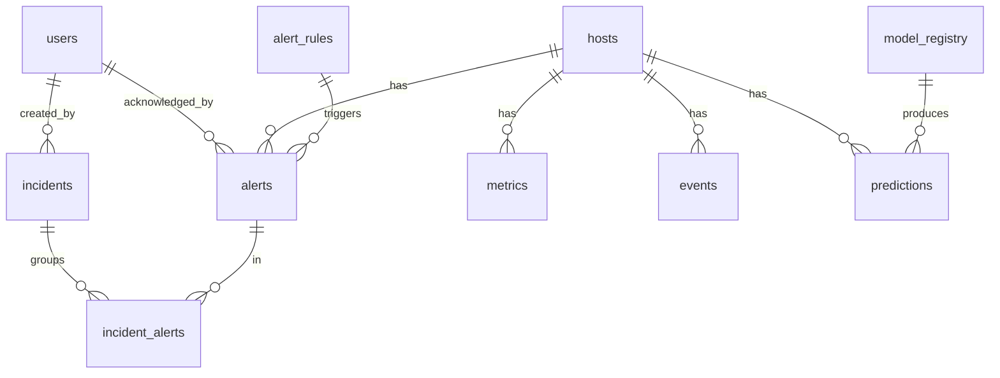

# 04 · Modelo de datos (PostgreSQL 16)

Convenciones: tablas en plural `snake_case`, PK `id`, timestamps `timestamptz` en UTC, `created_at` por defecto `now()`. Este DDL es la **fuente de verdad**; `models.py`, schemas Pydantic y tipos TS deben reflejarlo.

## Diagrama ER



## DDL

```sql
CREATE EXTENSION IF NOT EXISTS pg_trgm;

-- ===== Enums =====
CREATE TYPE user_role       AS ENUM ('admin','infra','developer','analyst','viewer');
CREATE TYPE host_kind       AS ENUM ('server','application','service','database');
CREATE TYPE host_status     AS ENUM ('up','degraded','down','unknown');
CREATE TYPE event_level     AS ENUM ('info','warning','error','critical');
CREATE TYPE severity_level  AS ENUM ('low','medium','high','critical');      -- UI: bajo, medio, alto, crítico
CREATE TYPE alert_status    AS ENUM ('active','acknowledged','resolved');
CREATE TYPE alert_origin    AS ENUM ('rule','model','correlation');
CREATE TYPE rule_operator   AS ENUM ('gt','gte','lt','lte');
CREATE TYPE incident_status AS ENUM ('open','investigating','resolved','closed');

-- ===== Usuarios =====
CREATE TABLE users (
  id             SERIAL PRIMARY KEY,
  email          VARCHAR(160) NOT NULL UNIQUE,
  full_name      VARCHAR(120) NOT NULL,
  password_hash  VARCHAR(255) NOT NULL,
  role           user_role    NOT NULL DEFAULT 'viewer',
  is_active      BOOLEAN      NOT NULL DEFAULT TRUE,
  created_at     TIMESTAMPTZ  NOT NULL DEFAULT now(),
  last_login_at  TIMESTAMPTZ
);

-- ===== Infraestructura =====
CREATE TABLE hosts (
  id            SERIAL PRIMARY KEY,
  hostname      VARCHAR(120) NOT NULL UNIQUE,      -- identificador que envía el recolector
  display_name  VARCHAR(120),
  kind          host_kind    NOT NULL DEFAULT 'server',
  environment   VARCHAR(40)  NOT NULL DEFAULT 'dev', -- dev | qa | prod
  area          VARCHAR(80),
  ip_address    INET,
  os            VARCHAR(80),
  cpu_cores     SMALLINT,
  mem_total_mb  INTEGER,
  status        host_status  NOT NULL DEFAULT 'unknown',
  is_active     BOOLEAN      NOT NULL DEFAULT TRUE,
  last_seen_at  TIMESTAMPTZ,
  created_at    TIMESTAMPTZ  NOT NULL DEFAULT now()
);

-- ===== Métricas (una fila por lectura del recolector) =====
CREATE TABLE metrics (
  id               BIGSERIAL PRIMARY KEY,
  host_id          INTEGER     NOT NULL REFERENCES hosts(id) ON DELETE CASCADE,
  ts               TIMESTAMPTZ NOT NULL,
  cpu_percent      REAL        NOT NULL,
  cpu_per_core     REAL[],
  mem_percent      REAL        NOT NULL,
  mem_used_mb      INTEGER,
  disk_percent     REAL        NOT NULL,
  disk_partitions  JSONB,                 -- [{mount, percent, used_gb, total_gb}]
  net_sent_bps     DOUBLE PRECISION,
  net_recv_bps     DOUBLE PRECISION,
  latency_ms       REAL,                  -- p. ej. ping/HTTP check del servicio
  error_rate       REAL,                  -- % respuestas 5xx (si aplica)
  is_available     BOOLEAN     NOT NULL DEFAULT TRUE,
  extra            JSONB
);
CREATE INDEX ix_metrics_host_ts ON metrics (host_id, ts DESC);
CREATE INDEX ix_metrics_ts      ON metrics (ts DESC);

-- ===== Logs / eventos =====
CREATE TABLE events (
  id          BIGSERIAL PRIMARY KEY,
  host_id     INTEGER     NOT NULL REFERENCES hosts(id) ON DELETE CASCADE,
  ts          TIMESTAMPTZ NOT NULL,
  level       event_level NOT NULL,
  source      VARCHAR(80) NOT NULL,       -- nginx, api, system, postgres...
  message     TEXT        NOT NULL,
  fingerprint VARCHAR(64),                -- hash del mensaje normalizado (agrupar repetidos)
  attributes  JSONB                       -- {status_code, path, exception...}
);
CREATE INDEX ix_events_host_ts   ON events (host_id, ts DESC);
CREATE INDEX ix_events_level_ts  ON events (level, ts DESC);
CREATE INDEX ix_events_msg_trgm  ON events USING gin (message gin_trgm_ops);

-- ===== Reglas de alerta =====
CREATE TABLE alert_rules (
  id                SERIAL PRIMARY KEY,
  name              VARCHAR(120)   NOT NULL,
  metric            VARCHAR(40)    NOT NULL,  -- cpu_percent | mem_percent | disk_free_percent | latency_ms | error_rate | risk_score | events_error_count
  operator          rule_operator  NOT NULL,
  threshold         REAL           NOT NULL,
  duration_minutes  SMALLINT       NOT NULL DEFAULT 0, -- debe sostenerse N min
  severity          severity_level NOT NULL,
  host_id           INTEGER REFERENCES hosts(id) ON DELETE CASCADE, -- NULL = todos
  enabled           BOOLEAN        NOT NULL DEFAULT TRUE,
  created_at        TIMESTAMPTZ    NOT NULL DEFAULT now()
);

-- ===== Modelos ML =====
CREATE TABLE model_registry (
  id                  SERIAL PRIMARY KEY,
  name                VARCHAR(80)  NOT NULL,     -- p. ej. ranger-risk
  version             VARCHAR(20)  NOT NULL,
  algorithm           VARCHAR(80)  NOT NULL,     -- IsolationForest + RandomForestClassifier
  horizon_minutes     SMALLINT     NOT NULL,
  trained_at          TIMESTAMPTZ  NOT NULL,
  n_samples           INTEGER,
  precision           REAL,
  recall              REAL,
  f1                  REAL,
  roc_auc             REAL,
  feature_importance  JSONB,                     -- {feature: importance}
  artifact_path       VARCHAR(255) NOT NULL,
  is_active           BOOLEAN      NOT NULL DEFAULT FALSE,
  UNIQUE (name, version)
);

-- ===== Predicciones =====
CREATE TABLE predictions (
  id                  BIGSERIAL PRIMARY KEY,
  host_id             INTEGER        NOT NULL REFERENCES hosts(id) ON DELETE CASCADE,
  model_id            INTEGER        REFERENCES model_registry(id),
  ts                  TIMESTAMPTZ    NOT NULL DEFAULT now(),
  anomaly_score       REAL,                      -- 0..1
  failure_probability REAL,                      -- 0..1 dentro del horizonte
  risk_score          REAL           NOT NULL,   -- 0..1 combinado
  risk_level          severity_level NOT NULL,
  is_anomaly          BOOLEAN        NOT NULL DEFAULT FALSE,
  top_factor          VARCHAR(80),               -- feature que más aporta
  features            JSONB
);
CREATE INDEX ix_predictions_host_ts ON predictions (host_id, ts DESC);

-- ===== Alertas =====
CREATE TABLE alerts (
  id               BIGSERIAL PRIMARY KEY,
  host_id          INTEGER        NOT NULL REFERENCES hosts(id) ON DELETE CASCADE,
  rule_id          INTEGER        REFERENCES alert_rules(id) ON DELETE SET NULL,
  prediction_id    BIGINT         REFERENCES predictions(id) ON DELETE SET NULL,
  origin           alert_origin   NOT NULL,
  severity         severity_level NOT NULL,
  status           alert_status   NOT NULL DEFAULT 'active',
  title            VARCHAR(160)   NOT NULL,
  description      TEXT,
  situation        VARCHAR(160),               -- "Degradación progresiva del servicio"
  evidence         JSONB,                      -- [{metric, value, detail}] ver 07
  trend            VARCHAR(20),                -- rising | stable | falling
  risk_score       REAL,
  suggested_action TEXT,
  dedup_key        VARCHAR(120)   NOT NULL,    -- host:origin:rule/metric
  occurrences      INTEGER        NOT NULL DEFAULT 1,
  first_seen_at    TIMESTAMPTZ    NOT NULL DEFAULT now(),
  last_seen_at     TIMESTAMPTZ    NOT NULL DEFAULT now(),
  acknowledged_by  INTEGER        REFERENCES users(id),
  acknowledged_at  TIMESTAMPTZ,
  resolved_at      TIMESTAMPTZ
);
CREATE INDEX ix_alerts_status_sev ON alerts (status, severity);
CREATE INDEX ix_alerts_host_ts    ON alerts (host_id, first_seen_at DESC);
CREATE UNIQUE INDEX ux_alerts_active_dedup ON alerts (dedup_key) WHERE status <> 'resolved';

-- ===== Incidentes =====
CREATE TABLE incidents (
  id          SERIAL PRIMARY KEY,
  title       VARCHAR(160)    NOT NULL,
  host_id     INTEGER         REFERENCES hosts(id) ON DELETE SET NULL,
  severity    severity_level  NOT NULL,
  status      incident_status NOT NULL DEFAULT 'open',
  description TEXT,
  root_cause  TEXT,
  resolution  TEXT,
  opened_at   TIMESTAMPTZ     NOT NULL DEFAULT now(),
  closed_at   TIMESTAMPTZ,
  created_by  INTEGER         REFERENCES users(id),
  assigned_to INTEGER         REFERENCES users(id)
);

CREATE TABLE incident_alerts (
  incident_id INTEGER NOT NULL REFERENCES incidents(id) ON DELETE CASCADE,
  alert_id    BIGINT  NOT NULL REFERENCES alerts(id)    ON DELETE CASCADE,
  PRIMARY KEY (incident_id, alert_id)
);
```

## Seed mínimo (`DB/init.sql` o script de arranque)

- Usuario admin desde `ADMIN_EMAIL` / `ADMIN_PASSWORD` (crearlo en el startup del backend, porque el hash se genera en Python).
- Reglas por defecto (coinciden con el mockup de Alertas):

| name | metric | operator | threshold | duration | severity |
|---|---|---|---|---|---|
| CPU alta sostenida | cpu_percent | gt | 90 | 5 | high |
| RAM alta | mem_percent | gt | 85 | 0 | medium |
| Disco libre bajo | disk_free_percent | lt | 10 | 0 | high |
| Riesgo del modelo alto | risk_score | gte | 0.6 | 0 | high |
| Ráfaga de errores | events_error_count | gte | 20 | 5 | medium |

## Consultas de referencia

```sql
-- Agregación para Historial (agrupar por minuto|hour|day)
SELECT date_trunc(:bucket, ts) AS period,
       AVG(cpu_percent) AS avg, MIN(cpu_percent) AS min, MAX(cpu_percent) AS max, COUNT(*) AS samples
FROM metrics
WHERE host_id = :host_id AND ts BETWEEN :from AND :to
GROUP BY period ORDER BY period;

-- Última lectura por host (dashboard)
SELECT DISTINCT ON (host_id) * FROM metrics ORDER BY host_id, ts DESC;

-- Disponibilidad (%) por host en rango
SELECT host_id, 100.0 * AVG(is_available::int) AS availability_pct
FROM metrics WHERE ts BETWEEN :from AND :to GROUP BY host_id;
```

## Retención (`[post-MVP]` si sobra tiempo)

Job diario que borra `metrics` crudas > 30 días tras guardar agregados horarios en una tabla `metrics_hourly`.
